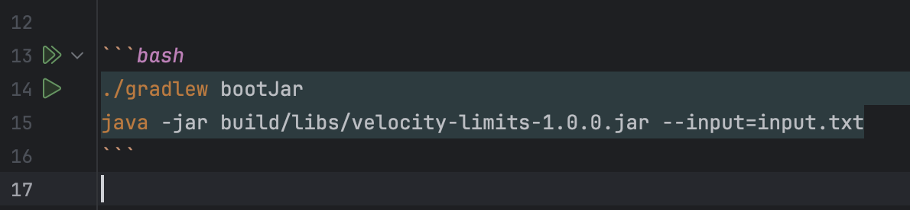
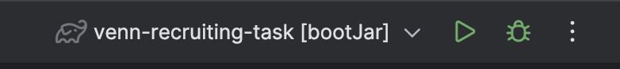
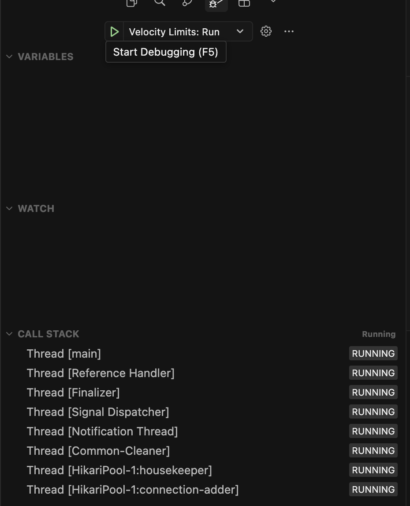

# Velocity Limits

Spring Boot command-line app that accepts or declines customer fund loads against per-customer velocity limits:

- max **$5,000** loaded per UTC day
- max **$20,000** loaded per week (Monday 00:00 UTC to Sunday 23:59:59 UTC)
- max **3** loads per UTC day

## Run

Requires JDK 17+; the Gradle wrapper is included, so no separate Gradle install is needed. Responses go to stdout (or `--output=<file>`), logs go to stderr, so stdout stays clean for piping or diffing.

### CLI

From the project root:

```bash
./gradlew bootJar
java -jar build/libs/velocity-limits-1.0.0.jar --input=input.txt
```

Limits can be changed without code changes, e.g. `--velocity.limits.daily-amount=10000`, so different environments can use different limits. Defaults match the spec.

### IntelliJ IDEA

Open the project in IntelliJ and click the run icon in the gutter next to `./gradlew bootJar` (or run `bootJar` from the Gradle tool window) to build the jar. Start it with the `java -jar` command above, or run/debug `VelocityLimitsApplication` directly.





### VS Code / Cursor

The `.vscode/` folder ships the recommended extensions (Language Support for Java, Debugger for Java, Test Runner for Java and Gradle for Java), Gradle import settings, and two launch configurations: **Velocity Limits: Run** and **Velocity Limits: Debug**.

On first open, accept the recommended extensions and wait for the Java extension to finish importing the Gradle project (progress in the status bar). Then open the **Run and Debug** view, pick a configuration, and press the green arrow (or `F5`). Both start the app from the project root with `--input=input.txt`.



Gradle tasks **Gradle: bootRun** and **Gradle: test** are also available from **Terminal → Run Task**.

## Test

`./gradlew test` runs the suite. `FundLoadProcessorIntegrationTest` runs the full `input.txt` and asserts the result equals `output.txt` line by line. `SyntheticEdgeCasesIntegrationTest` feeds hand-built NDJSON scenarios through the same pipeline, covering the spec's boundary cases: totals landing exactly on a limit, midnight and week edges (including across New Year), duplicate load ids, and amount shapes like `$5000` or `$0.01`.

## Design

```
FundLoadRunner      CLI args, opens input/output streams
FundLoadProcessor   reads NDJSON line by line, parses, writes responses, isolates bad lines
FundLoad            validated domain record (parses "$123.45" into BigDecimal, ISO time into Instant)
FundLoadService     per load, one transaction: lock customer -> duplicate check -> load activity -> decide -> persist
VelocityLimitPolicy pure decision function, no I/O; unit-tested in isolation
TimeWindow          UTC day / Monday-based week as half-open [from, to) intervals
LoadAttempt(+Repo)  JPA entity on in-memory H2: every decided attempt
Customer(+Repo)     one row per customer; its row lock serialises that customer's decisions
db/migration        Flyway migrations: the schema's single source of truth (Hibernate runs with ddl-auto: validate)
```

Design decisions:

- **Every non-duplicate attempt is persisted**, accepted or declined, with the decline reason as an enum. This gives an audit trail and makes support questions answerable from the database and logs.
- **Only accepted loads count towards limits.** A declined load does not use up daily count or amount.
- **Duplicates** are keyed on `(customer_id, load_id)`, enforced by a unique constraint, and ignored even if the first attempt was declined. The same load id under a different customer is processed normally.
- **Zero amounts are invalid.** The spec doesn't cover `$0.00`, but accepting it would move no money and still use up one of the customer's three daily loads. The schema also enforces `amount > 0`.
- **Limits are evaluated by one aggregate query** per load over the customer's week (day sum and count picked out by `CASE`). Input needn't be sorted, and a load never counts towards a window it falls outside of.
- **Error handling:** a bad record (invalid data) is logged at WARN and skipped with no response, since the spec defines none. Infrastructure failures (missing file, I/O, database down) stop the run with a non-zero exit code.
- **Logging:** Logs go to stderr, responses to stdout.

## Concurrency

The CLI is sequential, but `FundLoadService` is safe to call concurrently.

**Problem.** Each decision is a check-then-write: duplicate check, sum of the customer's accepted loads, insert. Under READ COMMITTED, two concurrent loads for one customer can read the same totals and both be accepted; 16 simultaneous $3,000 loads once gave up to 10 acceptances in a day.

**Fix.** A pessimistic lock per customer: each decision runs in one transaction that starts with `SELECT ... FOR UPDATE` on the customer row. Same-customer loads queue; different customers don't contend. The customer row is created on the customer's first load in its own short transaction, where losing the creation race is harmless. The unique `(customer_id, load_id)` constraint backs up the duplicate check.

`FundLoadServiceConcurrencyTest` fires 16 simultaneous loads for one customer and asserts exactly 3 acceptances (count limit), exactly 1 when each is $3,000 (amount limit), and one response for 16 copies of the same load id.

Rejected alternatives: `SERIALIZABLE` (retries, database-specific behaviour), a per-customer counter row (O(1) decisions, but needs rollover handling and a separate audit trail, e.g. for CloudWatch), and optimistic locking with `@Version` (needs retry handling).

**Assumption:** the input is chronological. Half-open windows keep the limits correct even if it isn't, and when callers race, "first" is whoever acquires the lock first — not the earliest timestamp.
